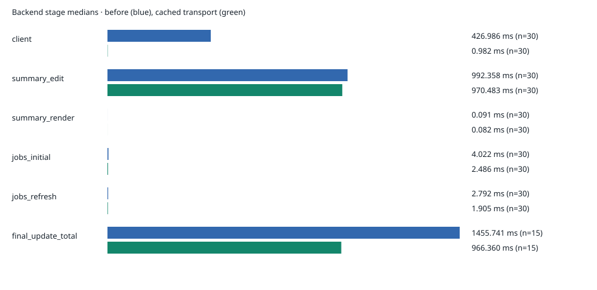
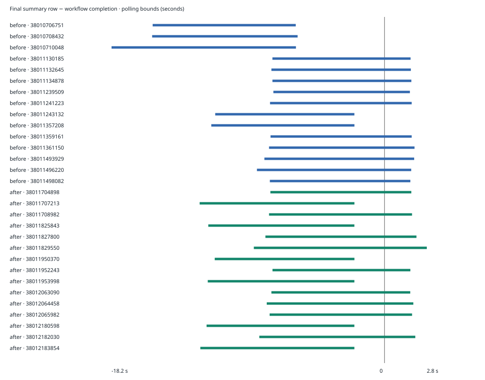

# Digger comment latency

An investigation into workflow completion, PR summary updates, and the cost of acquiring a GitHub installation token.

## Executive findings

The investigation tested whether PR summary comments remain stale after GitHub Actions completes, and measured where the backend spends time updating them.

The standard fixture produced **30 usable workflow observations** across five batches before and five after the change. All succeeded. Eleven summary rows were confirmed final before workflow completion; nineteen had overlapping observation intervals. No delayed row or reversal was confirmed. Short delays inside the polling intervals remain possible.

The implemented change reuses GitHub installation transports so their token cache survives between client creations. Median final-summary processing fell from **1,455.741 ms to 966.360 ms**, a reduction of **489.381 ms, or 33.6%**. That is a measured reduction in backend work; it does not establish that the original intermittent post-workflow delay is fixed.

> **Scope remains partial.** Standard-fixture measurements are complete. Small/heavy management-policy cases still require an EE test license.



## What was measured

Two measurements answer different questions:

| Measurement | Question | Tooling |
|---|---|---|
| Externally visible transitions | Was the correct summary row final before or after its workflow completed? | `measure.py`, authenticated `gh api`, monotonic request bounds |
| Backend processing | Where does comment processing spend elapsed time? | Opt-in Go stage timers, structured `comment_timing` records |
| CPU, allocation and waits | Does a separate workload profile identify expensive code? | Go pprof, runtime trace, `go tool trace -pprof=net` |
| Local operation | Does the real backend run and does the report render? | Docker Compose/PostgreSQL, native Go runner, Playwright/headless Chromium |

The observer uses the workflow URL in the row to establish correlation. It checks the repository, PR, run and attempt, polls every two seconds **plus API request time**, and continues for ten seconds after completion and final state are observed. It does not substitute GitHub’s generic `updated_at` timestamp for workflow completion or measure browser refresh latency.

A transition is bounded by the last observation that did not match and the first that did. The difference between comment and completion intervals gives a delay interval. An interval wholly below zero establishes an already-final row; one wholly above zero establishes a delayed row. An interval crossing zero remains inconclusive. Matching on the first poll is unverified and excluded here.

Go durations use a monotonic clock. Instrumentation is enabled only by `DIGGER_COMMENT_TIMING=1`. New timing events contain stage, writer, span ID, UTC bounds, duration, outcome and available job/batch/comment identifiers; no payload or credential fields are added. Existing application logs remain private. **Nested stages are inclusive and must not be summed.**

## Local setup and experiment

The backend ran natively on loopback with PostgreSQL 16 in a scoped Docker Compose project. Atlas applied 156 migration statements. The Docker backend build was stopped during dependency downloads; the native runner reused the backend’s real bootstrap and controller.

A dedicated GitHub App was installed on the three test repositories. A filtered tunnel routed webhooks and authenticated job callbacks while keeping profiling endpoints local. Headless Chromium recorded local setup and the report; credential pages were excluded.

| Fixture | Role | Result |
|---|---|---|
| `s1ntaxe770r/terragrun-test` | Existing PR 21; three plain Terraform projects | Five usable batches per phase |
| `s1ntaxe770r/digger-small-management-repo` | Small management-policy input | App installed; EE license needed |
| `s1ntaxe770r/digger-heavy-management-repo` | Heavy management-policy input | App installed; EE license needed |

The live workload used [existing PR 21](https://github.com/s1ntaxe770r/terragrun-test/pull/21). Its test-branch configuration was corrected from `root_dir: infra/` to `include: infra/**`. The workflow definition lived on `perf/comment-latency-20261010`. Plans were allowed; applies were rejected. No PR was created.

The first successful batch followed the PR synchronization event. Later batches replayed its signed event through the test tunnel. Workflow dispatch, Actions execution, callbacks, and GitHub comment writes were real.

| Controlled input | Revision / setting |
|---|---|
| Fixture PR head | `929d95803e84377b41ddb23c237ef0aba07b5267` |
| Test workflow definition | `d952ef95ed83f8273c005e9a1b9f0f90a27f1ab4` |
| CLI source, both phases | `c1962300fa40d9cd07b39f737c556ea268c8ebac` |
| Instrumented baseline backend | `c1962300fa40d9cd07b39f737c556ea268c8ebac` |
| Cached-transport backend | `6de55a6717c981934fe241434e30571091bbb59b` |
| Local / Actions toolchain | Go 1.27.0 on Apple M3 Pro / Go 1.25.6 on Ubuntu |
| Instrumentation | Enabled in both phases |

Both phases used the same fixture revision, workflow definition, and pinned CLI source. The before CLI reversed the synthetic renderer patch; after retained it. That updater is inactive in this live path, so this difference contributes no summary-rendering work. The backend transport cache is the live behavioral change under test.

Three late baseline observations were retained but excluded. Three additional workflows ran under profiling and were also excluded. In total, 36 successful workflows were recorded: 30 usable comparison observations, three late observations, and three diagnostic runs. The earlier invalid fixture configuration produced no measured workflow batch.

## Results and uncertainty

| Measurement | Before median | After median | Change | Samples per phase |
|---|---:|---:|---:|---:|
| Final-summary update | 1,455.741 ms | 966.360 ms | −33.6% | 15 |
| Client setup | 426.986 ms | 0.982 ms | −99.8% | 30 |
| Summary edit | 992.358 ms | 970.483 ms | −2.2% | 30 |
| Rendering | 0.091 ms | 0.082 ms | −9.8% | 30 |
| Initial job read | 4.022 ms | 2.486 ms | −38.2% | 30 |
| Refreshed job read | 2.792 ms | 1.905 ms | −31.8% | 30 |

Final-update totals carry an explicit job status. Component timings identify the batch and include both running and final updates; overlapping child spans cannot safely be assigned to individual final updates. The table’s percentages describe sample medians, not each individual run.

Client setup contained substantial avoidable work. GitHub comment editing remained close to one second and is the largest measured remaining cost. Rendering was below 0.1 ms median, and database stages were a few milliseconds. The `client` stage includes service/client setup; it is not an isolated token-endpoint benchmark.

| External observation | Before | After |
|---|---:|---:|
| Confirmed final before completion | 5 | 6 |
| Overlapping bounds / inconclusive | 10 | 9 |
| Confirmed delayed | 0 | 0 |
| Observed reversions | 0 | 0 |
| Late observations, excluded | 3 | 0 |



Intervals entirely left of zero establish that the row was final before completion. Crossing zero means the polling evidence cannot determine which transition happened first. Transient reversions between polls or after the stability window could be missed.

These are exploratory measurements from serial batches. Jobs within a batch are related, GitHub latency varies, and some baseline runs overlapped local compilation. The percentages are descriptive comparisons, not randomized causal estimates or reliable tail statistics. See the [machine-readable comparison](evidence/live/comparison.json) for ranges, counts and individual outcomes.

## Execution path

`SetJobStatusForProject` updates job state and launches an asynchronous comment update. `UpdatePRComment` calls `UpdatePRCommentRealtime`, which obtains a GitHub service, reads current batch/job data, renders the summary, and edits or creates its comment.

```text
CLI reports a job status
  └─ SetJobStatusForProject                 backend/controllers/projects.go
       └─ asynchronous UpdatePRComment     backend/utils/comment_utils.go
            └─ UpdatePRCommentRealtime
                 ├─ GetPrServiceFromBatch → GetGithubService
                 │    └─ DiggerGithubRealClientProvider.Get
                 │         └─ installation transport / token cache
                 ├─ initial jobs → refreshed batch → refreshed jobs
                 ├─ GenerateRealtimeCommentMessage
                 └─ UpdateOrCreateSummaryComment
                      └─ GithubService.EditComment → GitHub API
```

The observer measures workflow and comment visibility independently of this path. A final job callback and backend update can precede overall Actions completion. The final-summary timer starts inside the backend; it does not include time before the callback arrives or subsequent browser refresh.

`UpdateOrCreateSummaryComment` already falls back to publishing a new comment when editing fails. This behavior and asynchronous write ordering were preserved. The cache does not resolve potential competing backend writes.

## Changed code paths

The runtime change is in `backend/utils/github.go`. Previously, each provider call constructed an installation transport and requested its token. The new cache keys transports by App ID, installation ID, and private-key fingerprint. The library retains responsibility for synchronized token refresh and expiry.

```go
key := installationTransportKey{appID, installationID, sha256.Sum256(privateKey)}
if transport, ok := installationTransports.Load(key); ok {
    return transport.(*cachedInstallationTransport), nil
}
```

A cache miss constructs a transport and uses `LoadOrStore` so callers share the retained instance. First acquisition still needs GitHub; subsequent client creation can reuse a valid token. The existing client and logging wrapper are still created per call.

```go
if response != nil && response.StatusCode == net.StatusUnauthorized {
    installationTransports.CompareAndDelete(t.key, t)
}
```

HTTP 401 removes the matching cached transport for subsequent client creation. A late 401 from an old transport cannot evict its replacement. This adds no automatic retry and does not serialize comment writers. Cache entries have no size bound and remain until invalidation or process exit.

| File | Change | Purpose |
|---|---|---|
| `backend/utils/github.go` | Installation transport cache and 401 invalidation | Avoid repeated token acquisition |
| `backend/utils/github_transport_test.go` | New concurrency/lifecycle tests | Check reuse and isolation |
| `backend/controllers/projects.go` | Request timer | Measure status-handler elapsed time/outcome |
| `backend/utils/comment_utils.go` | Stage timers and final-status outer timer | Attribute update work |
| `libs/ci/github/github.go` | Comment edit timer | Measure GitHub edit calls |
| `libs/comment_utils/latency/timing.go` | New opt-in helper | Consistent correlated timing records |
| `libs/comment_utils/latency/timing_test.go` | Helper tests | Check opt-in and event outcomes |
| `libs/comment_utils/summary/updater.go` | Timing and `strings.Builder` experiment | Synthetic utility benchmark; inactive here |
| `libs/comment_utils/summary/updater_test.go` | Output tests and benchmarks | Preserve formatting/truncation |

The browser appendix below provides exact diffs and pinned source links for these paths. [Full investigation diff](https://github.com/s1ntaxe770r/digger/compare/1b31c38995ea6fd819e608a25f3a1d8e3bfab8a2...5123455f).

<!-- CODE_REVIEW -->

## Tooling and artifacts

The diagnostic harness is under `scripts/comment_latency/`. It does not introduce a production profiling service.

| Files | Responsibility |
|---|---|
| `measure.py`, `stages.py`, `live_report.py` | Observe transitions, aggregate timings, generate reports |
| `observe_dispatches.py`, `replay_pr.py`, `run_series.py` | Correlate real dispatches, replay signed test events, run serial batches |
| `local_main.go`, `start_backend.py` | Reuse real backend bootstrap; select test workflow ref; record build identity |
| `compose.yaml`, `backend.env.example`, `webhook_proxy.py` | Scoped PostgreSQL/backend configuration and restricted tunnel routing |
| `fixture-workflow.yml` | Pinned CLI build, source/binary hashes and plan-only guard |
| `profile_live.py`, `browser_smoke.py` | Separate pprof/trace capture and headless browser recording |
| `benchmark_report.py`, `test_measure.py`, `test_stages.py` | Synthetic reports and measurement regression coverage |
| `.gitignore`, root `.dockerignore` | Exclude private credentials, logs and generated local artifacts |

[Reproduction runbook](README.md) · [before stage records](evidence/live/before-stages.jsonl) · [after stage records](evidence/live/after-stages.jsonl) · [baseline build identity](evidence/live/backend-before-build.json) · [candidate build identity](evidence/live/backend-after-build.json).

## Profiling and validation

A separate three-workflow diagnostic batch captured 120 seconds of CPU and runtime activity. All six running/final updates fell inside that window. The CPU profile contained only **550 ms of samples (0.46%)**, too little to establish an application CPU hotspot. CPU and trace capture ran together; profiling overhead is included.

Aggregate trace waits include idle and concurrent waits; they are not request latency. The **91.96 MB allocation snapshot** covers process lifetime, not one batch or retained memory. These profiles do not support a memory-leak claim.

[CPU profile summary](evidence/live/cpu-top.txt) · [allocation profile](evidence/live/allocation-top.txt) · [network waits](evidence/live/network-wait-top.txt) · [diagnostic run IDs](evidence/live/profile.json).

| Check | Result |
|---|---|
| Transport cache tests with race detector | Passed: concurrent reuse, identity/key isolation, expiry, revocation, stale 401 |
| Python observer/report/stage tests | 16 passed |
| Go timing and summary-output tests | Passed |
| Affected backend/CLI packages | Compiled |
| Existing GitHub suite with `CI=true` | Passed; App-specific 388-repository test skipped |
| Published medians and graph values | Independently checked against retained records |
| SVGs, report links and browser rendering | Verified |

A separate `strings.Builder` experiment improved the synthetic 1,000-job utility median from 4.6396 to 0.6587 ms. However, **`CommentUpdaterProviderBasic.Get` returns `NoopCommentUpdater`** in the tested CLI. That renderer is inactive here and contributes none of the live gain. The earlier hypothesis of competing CLI and backend summary writers was corrected. [Synthetic evidence](evidence/synthetic-render.md).

## Recordings and evidence

The setup recording documents the local backend setup page. The health/report recording shows a successful health check and the original timing report. Neither is a recording of private credential entry or a measurement of GitHub browser-refresh latency.

<!-- RECORDINGS -->

[Local setup video](results/local-startup/backend-setup.webm) · [health/report video](results/local-startup/live-review.webm) · [report screenshot](results/local-startup/live-report.png).

Credentials, raw application logs and binary profiles remain in ignored local results. Sanitized timing records, observations, build identities, graphs and profile summaries are committed. Local recordings remain local and are not included in the Git branch.

## Remaining work

Small/heavy management-policy scenarios still require an EE test license and have no measured conclusion. Production load, overlapping batches, and browser refresh behavior were not tested. The available evidence does not identify every possible bottleneck or disprove intermittent delays.

The next investigation should capture an actual delayed run with this instrumentation, then determine whether time is spent before the backend receives status, inside processing, during GitHub requests, or in competing backend writes. Ordering or error-handling changes should follow evidence from that case.

Implementation and evidence are on `perf/action-comment-latency`. No PR was created. The standard-fixture result is ready for review; all-fixture acceptance remains incomplete.
